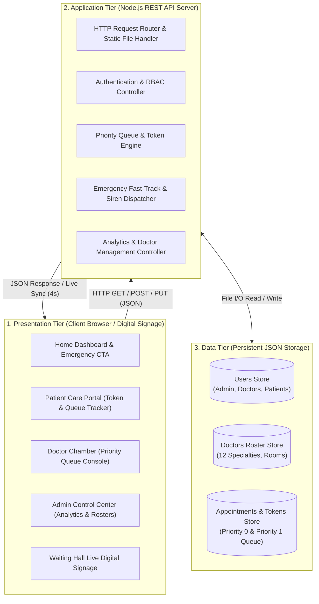
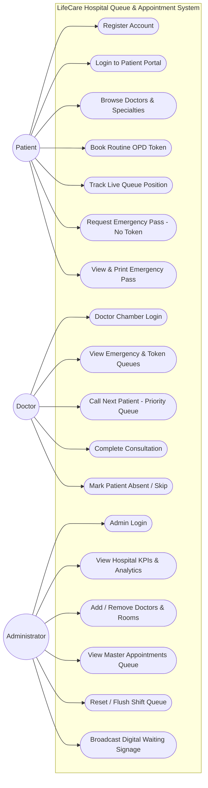
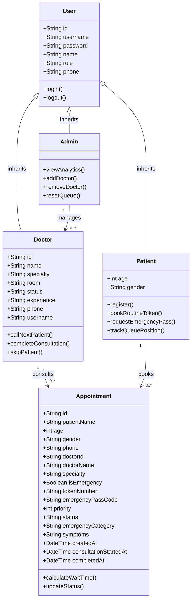
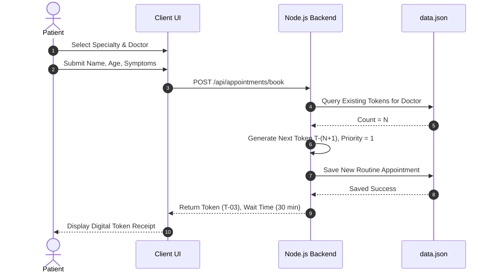
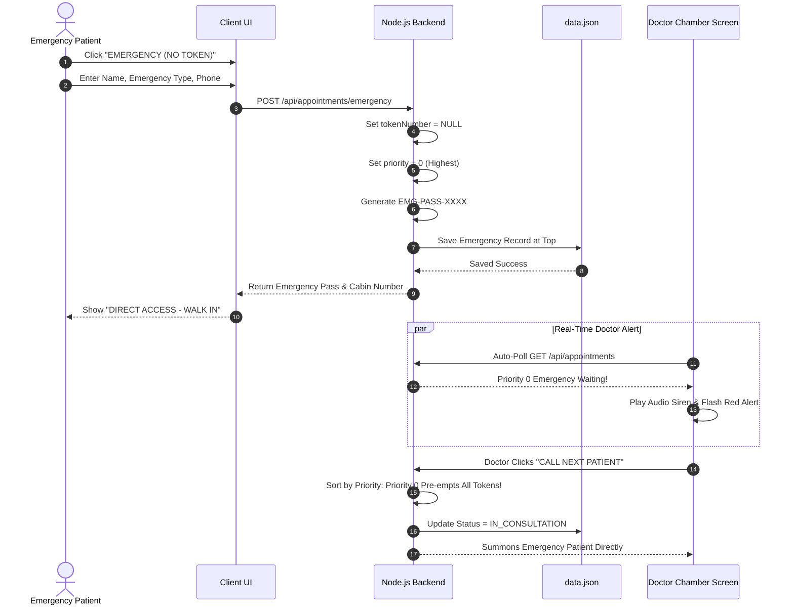
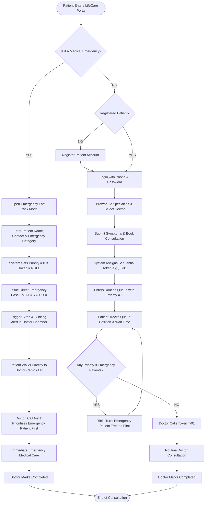

# “LIFECARE – SMART HOSPITAL QUEUE AND APPOINTMENT MANAGEMENT SYSTEM WITH EMERGENCY FAST-TRACK BYPASS”

### A Course Project Report
**Submitted in the partial fulfillment of the completion of the course**  
### SOFTWARE ENGINEERING AND SYSTEM DESIGN  
**(24CS301PC311)**  
**In III Year, I Semester B. Tech - CSE**

---

**Submitted by:**  
**Student Name:** [Your Name]  
**Roll Number:** 2403A52137  

**Under the supervision of the faculty:**  
**Course Faculty / Supervisor:** [Faculty Name]  
**School of Computer Science & Artificial Intelligence**  
**2026 – 2027**

---

### Department of Computer Science & Artificial Intelligence  
### SR University  
**Warangal, Telangana, India**

---

## Report Structure

| S. No. | Contents | Page No. |
| :---: | :--- | :---: |
| **1** | Abstract | 3 |
| **2** | Introduction | 4 |
| 2.1 | Problem Statement | 4 |
| 2.2 | Objectives | 5 |
| 2.3 | Scope | 5 |
| **3** | Software Requirements Specification (SRS) | 6 |
| 3.1 | Functional Requirements | 6 |
| 3.2 | Non-Functional Requirements | 7 |
| 3.3 | Hardware and Software Requirements | 8 |
| **4** | System Analysis | 9 |
| 4.1 | Existing System | 9 |
| 4.2 | Proposed System | 10 |
| **5** | System Design | 11 |
| 5.1 | System Architecture | 11 |
| 5.2 | Use Case Diagram | 13 |
| 5.3 | Class Diagram | 15 |
| 5.4 | Sequence Diagram | 17 |
| 5.5 | Activity Diagram | 19 |
| **6** | Methodology | 21 |
| **7** | Implementation | 22 |
| **8** | Testing | 24 |
| **9** | Output Description & Screen Walkthrough | 25 |
| **10** | Conclusion | 28 |
| **11** | References | 29 |

---

## 1. ABSTRACT

**LifeCare** is a Smart Hospital Queue and Appointment Management System developed to transform outpatient department (OPD) queue handling, minimize waiting times, and provide an automated **Emergency Fast-Track Bypass** for critical patients. In conventional hospital setups, patients must physically stand in crowded queues to receive manual tokens, creating immense discomfort and dangerous delays. Crucially, during acute life-threatening medical emergencies (such as heart attacks, road accidents, or severe pediatric respiratory distress), making patients wait in standard token queues can lead to fatal outcomes.

The LifeCare web application provides four dedicated, role-based modules: **Patient Portal**, **Doctor Chamber**, **Hospital Administrator**, and a public **Live OPD Digital Signage Display Board**.

- **Patients** can register, log in, browse doctors across 12 medical specialties, book routine OPD appointments, receive sequential token numbers (`T-01`, `T-02`, etc.), view real-time queue position ("X patients ahead"), and track estimated waiting times.
- **Emergency Bypass Protocol:** For urgent medical emergencies, patients or relatives can request an **Instant Emergency Pass** with a single click. The system **completely bypasses token numbering**, issues an authorized Priority Level 0 Emergency Pass (`EMG-PASS-XXXX`), triggers an instant audio-visual chime in the doctor's cabin, and pre-empts all routine tokens so the patient is directed straight into the consultation room with zero wait time.
- **Doctor Chamber** allows medical practitioners to view their live queue split into two sections: high-priority Emergency Admissions and sequential routine tokens. The "Call Next Patient" algorithm executes a pre-emptive Priority Queue that automatically summons emergency cases first before serving routine tokens. Doctors can mark consultations as in-progress, completed, or skipped.
- **Admin Dashboard** provides real-time hospital analytics (total patient footfall, active emergency cases, doctor rosters, average wait times), doctor profile management, and master queue control.
- **Live Digital Signage Display** functions as a waiting-hall TV display, broadcasting chamber rooms, active doctor names, currently consulting tokens, and emergency alert notices in real time.

The application is built using **Node.js, Express REST API architecture, HTML5, CSS3, Tailwind CSS, JavaScript (ES6+), and JSON-based persistent storage**. LifeCare successfully eliminates physical queue bottlenecks, enforces pre-emptive emergency triage, and provides a modern healthcare experience.

---

## 2. INTRODUCTION

Healthcare operations require speed, accuracy, and compassionate accessibility. Outpatient departments (OPD) in hospitals handle hundreds to thousands of patients daily. Traditionally, patients arrive at the hospital, stand in long reception queues to obtain paper slips or physical tokens, and wait for uncertain hours in congested waiting areas without knowing their turn or queue status. 

Such unorganized crowding leads to patient frustration, administrative chaos, and cross-infections. More severely, when an acute emergency occurs, traditional reception lines lack an automated mechanism to dynamically re-prioritize clinical attention, often causing catastrophic treatment delays.

**LifeCare** addresses these challenges by digitizing the appointment booking, queue tracking, and clinical triage workflow into a single responsive web platform. Patients can book OPD tokens from their smartphones or computers, track their live waiting status remotely, and arrive at the doctor's chamber right on time. During emergency situations, the application offers an automated **Zero-Token Emergency Bypass**, ensuring immediate doctor assignment and instant clinical intervention.

### 2.1 Problem Statement
Traditional hospital appointment and queue management systems rely heavily on manual reception counters and physical paper tokens. This manual approach causes several critical problems:
1. **Prolonged Physical Waiting:** Patients and their caregivers spend multiple unproductive hours waiting in crowded hospital lobbies.
2. **Lack of Real-Time Queue Transparency:** Patients have no visibility into how many patients are ahead of them or the estimated time remaining for their consultation.
3. **Emergency Bottleneck:** In critical medical emergencies, there is no automated digital mechanism to pre-empt standard queues, risking life-threatening delays.
4. **Administrative Overload:** Manual tracking of doctor availability, room allocation, and patient records creates errors and excessive administrative burden.
5. **No Centralized Signage Display:** Waiting halls lack synchronized digital display boards to guide patients to their respective doctor rooms.

Therefore, **LifeCare** is developed to provide a centralized, real-time web application that automates routine OPD token allocation, optimizes clinical scheduling, and enforces instantaneous emergency access.

### 2.2 Objectives
The primary objectives of the LifeCare project are:
- To design and implement a responsive web application for hospital queue and appointment management.
- To provide secure patient authentication, profile management, and appointment history.
- To catalog doctors across 12 distinct medical specialties with live room status.
- To implement an automated sequential token generation algorithm (`T-01`, `T-02`, etc.) for routine OPD bookings.
- To calculate and display dynamic queue positions and estimated wait times in real time.
- **To implement an Emergency Fast-Track Bypass system that dispenses Zero-Token Emergency Passes with Priority Level 0.**
- To trigger real-time audio-visual sirens and alerts in doctor chambers during emergency arrivals.
- To build a dedicated Doctor Chamber portal with pre-emptive priority calling ("Emergency First, FIFO Regular Next").
- To provide an Admin Control Center for monitoring hospital KPIs, doctor rosters, and master queue flushes.
- To create a public Digital Waiting Signage board for hospital waiting hall TV screens.

### 2.3 Scope
The operational scope of LifeCare encompasses four major modules:
1. **Patient Management:** Self-registration, phone/username login, specialty browsing, routine token generation, live queue tracker, active passes, and consultation history.
2. **Emergency Triage Module:** Instant emergency booking without token numbers, classification by acute emergency category, automated Priority 0 tag, Emergency Pass code issuance, and doctor room routing.
3. **Doctor Chamber Module:** Secure doctor login across 12 clinical specialties, real-time chamber queue split (Emergency vs Regular), Priority Queue "Call Next" engine, consultation timer, and completion logger.
4. **Admin & Analytics Module:** Executive KPI dashboard (total visits, active emergency count, average wait time), doctor roster maintenance (add/delete doctors, assign rooms), and hospital-wide queue monitoring.
5. **Digital Display Signage:** Full-screen digital display mode for waiting lobby screens with live 4-second synchronization.

---

## 3. SOFTWARE REQUIREMENTS SPECIFICATION (SRS)

### 3.1 Functional Requirements

| Module | Functional Requirements |
| :--- | :--- |
| **Patient Registration & Login** | Patients can register with name, phone, age, gender, and password. Registered patients can log in securely using phone/username. |
| **Doctor Catalog** | Displays all 12 registered hospital doctors with specialty, experience, room number, contact, and live availability. |
| **Routine Token Booking** | Patients choose doctor and symptoms to generate sequential tokens (`T-01`, `T-02`) with calculated wait times. |
| **Emergency Fast-Track (No Token)** | Patients bypass token queues during acute emergencies; generates `EMG-PASS-XXXX` with Priority 0 for instant doctor routing. |
| **Live Queue Tracking** | Patients track live queue progress ("Now Serving", "Patients Ahead", "Estimated Wait Time"). |
| **Doctor Authentication** | Doctors log in using Doctor Name / Username (`dr.vikram`, `dr.ramesh`) and password (`doc123`). |
| **Priority Queue Engine** | "Call Next Patient" algorithm evaluates priority: Priority 0 (Emergency) called first, followed by FIFO routine tokens. |
| **Consultation Management** | Doctors can start consultation, complete consultation, or mark absent/skipped patients. |
| **Emergency Siren Alert** | Generates synthetic Web Audio API chime and blinking visual alerts in doctor cabins upon emergency booking. |
| **Admin Analytics** | Real-time calculation of total visits, active emergencies, in-consultation count, and average wait time. |
| **Doctor Roster Management** | Administrators can add new doctors, specify room numbers, and remove doctors from the roster. |
| **Master Queue Reset** | Administrators can flush shift queues for new OPD sessions. |
| **Public Display Board** | Auto-refreshing digital signage view displaying room numbers, doctor names, and now-serving tokens. |

### 3.2 Non-Functional Requirements
- **Usability:** Clean, intuitive UI built with Tailwind CSS, accessible across mobile phones, tablets, and desktop displays.
- **Performance & Latency:** API endpoints respond in under 50 milliseconds; live queue polls and updates every 4 seconds.
- **Reliability & Pre-emption:** Emergency cases immediately pre-empt standard queues without data loss or race conditions.
- **Portability & Zero Dependencies:** Pure Node.js standard library implementation runs out of the box on Windows, Linux, or Cloud without heavy external dependencies.
- **Security & RBAC:** Role-Based Access Control isolates Patient, Doctor, and Administrator capabilities.
- **Maintainability:** Modular separation between API routes, persistent JSON store, and client-side view logic.
- **Availability:** 24/7 cloud readiness compatible with Render, Railway, or local intranet deployment.

### 3.3 Hardware and Software Requirements

#### Hardware Requirements
| Hardware Component | Minimum Specification | Recommended Specification |
| :--- | :--- | :--- |
| **Processor** | Intel Core i3 (2.0 GHz) or AMD Ryzen 3 | Intel Core i5 / AMD Ryzen 5 or higher |
| **RAM** | 4 GB | 8 GB or higher |
| **Storage** | 500 MB free hard drive space | 2 GB SSD free space |
| **Input Devices** | Keyboard and Mouse / Touchscreen | Standard Keyboard & Mouse |
| **Display Device** | 1366 x 768 Resolution Monitor | Full HD 1920 x 1080 LED Screen |
| **Network Interface** | Standard NIC / Wi-Fi adapter | Broadband Internet / Local Hospital LAN |

#### Software Requirements
| Software Component | Specification |
| :--- | :--- |
| **Operating System** | Windows 10/11, macOS, or Ubuntu Linux |
| **Runtime Environment** | Node.js (v18.x or v20.x LTS) |
| **Server Engine** | Node.js Built-in HTTP Engine / Express.js REST Framework |
| **Frontend Framework** | HTML5, Tailwind CSS (CDN), FontAwesome 6 Icons |
| **Client Scripting** | JavaScript (ES6+ Vanilla Engine, Web Audio API) |
| **Database / Persistence** | Persistent JSON Database (`data.json`) / REST Data Store |
| **Version Control** | Git & GitHub |
| **Code Editor** | Visual Studio Code (VS Code) |
| **Web Browser** | Google Chrome, Microsoft Edge, or Mozilla Firefox |
| **Cloud Deployment** | Render.com Web Service / Local Host |

---

## 4. SYSTEM ANALYSIS

### 4.1 Existing System
In the existing manual or legacy hospital OPD system, patients must physically travel to the hospital early in the morning, stand in long admission lines, receive a handwritten slip or mechanical token, and wait in crowded lobbies.

#### Limitations of Existing System:
1. **Unpredictable Waiting Times:** Patients have no estimate of when their consultation will begin, resulting in hours of idle waiting.
2. **Fatal Emergency Delays:** Critical patients arriving during rush hours must negotiate manual reception desks or risk being queued behind non-critical routine consultations.
3. **High Administrative Overhead:** Manual registration registers, doctor availability boards, and physical token counters require extensive human labor.
4. **Lobby Congestion & Infection Risk:** Overcrowded waiting halls increase hospital-acquired cross-infections among immunocompromised patients.
5. **No Unified Communication:** Doctors have no real-time dashboard to preview incoming emergency trauma cases before the patient reaches the door.

### 4.2 Proposed System
The proposed **LifeCare** system replaces manual counters with an intelligent, multi-portal digital appointment and queue engine. Patients book appointments remotely, receive digital tokens, and track queue movement live. 

Most importantly, LifeCare introduces the **Emergency Zero-Token Protocol**:
- Emergency patients are tagged with **Priority Level 0**.
- Token generation is completely bypassed.
- An Emergency Pass code is generated instantly.
- The assigned doctor’s screen sounds an alert chime and places the emergency patient at the very head of the queue.
- Routine tokens (`Priority Level 1`) resume sequentially once all active emergency admissions are addressed.

#### Advantages of Proposed System:
- **Zero-Wait Emergency Admissions:** Immediate clinical attention for critical cardiac, trauma, stroke, and pediatric emergencies.
- **Predictable Routine Visits:** Patients monitor live wait times from home and arrive just before their token is called.
- **Dynamic Pre-emptive Priority Queue:** Intelligent algorithmic sorting of patients based on urgency rather than simple arrival time.
- **Centralized Hospital Management:** Administrators maintain doctor rosters and track facility KPIs from an executive dashboard.
- **Real-Time Waiting Signage:** Waiting rooms feature automated digital signage synchronized every 4 seconds.

---

## 5. SYSTEM DESIGN

### 5.1 System Architecture
LifeCare is built upon a robust **3-Tier Web Architecture**:

1. **Presentation Tier (Frontend):** Responsive Single Page Application (SPA) built with HTML5, Tailwind CSS, FontAwesome icons, and Vanilla JavaScript. Operates role-based views for Patients, Doctors, Administrators, and Public Displays.
2. **Application Tier (Backend Logic):** Node.js server handling REST API routes, password verification, sequential token generation, and the pre-emptive Priority Queue algorithm.
3. **Data Tier (Database):** Persistent JSON storage (`data.json`) storing doctor profiles, user credentials, active queue tickets, and emergency logs.

---

### 5.2 Use Case Diagram

The system involves three primary human actors: **Patient**, **Doctor**, and **Hospital Administrator**.

---

### 5.3 Class Diagram

The class diagram illustrates the primary entities, attributes, operations, and relationships governing the LifeCare system.

---

### 5.4 Sequence Diagram

#### Sequence A: Routine Appointment Booking & Queue Progression

#### Sequence B: Emergency Fast-Track Bypass (No Token)

---

### 5.5 Activity Diagram

The activity diagram models the dual-path decision flow between routine consultation booking and emergency bypass triage.

---

## 6. METHODOLOGY

The development of the LifeCare project followed the **Agile Iterative Software Engineering Methodology**, structured across the following distinct phases:

1. **Requirement Analysis:** Comprehensive identification of hospital bottlenecks through clinical queue reviews. Derived distinct user stories for patients needing remote tokens versus emergency patients requiring instantaneous triage bypass.
2. **System Design & Modeling:** Formulation of the 3-Tier Web Architecture. Creation of UML diagrams (Use Case, Class, Sequence, and Activity Diagrams) and definition of the pre-emptive Priority Queue algorithm.
3. **Database & Data Modeling:** Formulation of persistent schema objects representing Users, 12 Doctor Specializations, and Appointments with priority fields (`priority: 0` vs `priority: 1`).
4. **Backend REST API Development:** Built in pure Node.js utilizing standard HTTP modules and Express routing paradigms for high portability. Implemented route controllers for authentication, token generation, emergency pass issuance, status transitions, and doctor roster maintenance.
5. **Frontend UI & Generative Dashboard:** Engineered using HTML5, modern Tailwind CSS, and Vanilla JavaScript. Implemented single-page navigation, audio siren synthesis using the browser's native Web Audio API, and automatic 4-second asynchronous polling.
6. **System Integration & Testing:** Rigorous validation of edge cases including concurrent emergency arrivals, queue order verification, invalid credential handling, and cross-browser responsiveness.
7. **Cloud Deployment & CI/CD:** Repository versioning on GitHub (`https://github.com/2403a52137-eng/hospital-queue-management-system`) and cloud deployment on Render.com Web Services.

---

## 7. IMPLEMENTATION

### Implementation File Structure

| File Name | Location | Functionality & Implementation Details |
| :--- | :--- | :--- |
| **`server.js`** | Root Directory | Main Node.js backend server; hosts REST API endpoints, parses JSON requests, serves static frontend assets, and executes the Priority Queue dispatch engine. |
| **`server-express.js`**| Root Directory | Alternative Express.js framework implementation for modular routing and enterprise middleware integration. |
| **`data.json`** | Root Directory | Persistent JSON database storing accounts, 12 doctor specialties, appointments, active passes, and tokens. |
| **`package.json`** | Root Directory | Project metadata, scripts (`npm start`), and environment configurations. |
| **`public/index.html`**| `public/` | Responsive Single Page Application UI with Tailwind CSS layout, modal dialogs, and navigation tabs. |
| **`public/app.js`** | `public/` | Client-side controller handling API fetches, 4-second live synchronization, Web Audio API chime synthesis, and DOM rendering. |
| **`public/styles.css`**| `public/` | Custom CSS animations (emergency pulsing glow), scrollbars, and printable pass layouts. |
| **`start-app.bat`** | Root Directory | One-click Windows automation batch script to launch the server and open Chrome automatically. |

### Core Implemented Features:
1. **12 Multi-Specialty Doctor Chambers:**
   - Dr. Vikram Rao (Emergency & Trauma Care — ER Chamber 1)
   - Dr. Ramesh Varma (General Medicine — Room 101)
   - Dr. Priya Sharma (Cardiology / Heart Care — Room 102)
   - Dr. Suresh Kumar (Orthopedics & Joint Care — Room 103)
   - Dr. Ananya Reddy (Pediatrics / Child Specialist — Room 104)
   - Dr. Rajesh Kulkarni (Neurology & Spine — Room 105)
   - Dr. Sneha Mukherjee (Dermatology / Skin & Hair — Room 106)
   - Dr. Arvind Swamy (Pulmonology & Chest Medicine — Room 107)
   - Dr. Meenakshi Sundaram (Obstetrics & Gynecology — Room 108)
   - Dr. Harish Chandra (ENT — Room 109)
   - Dr. Deepa Nambiar (Ophthalmology / Eye Care — Room 110)
   - Dr. Sanjay Verma (Gastroenterology — Room 111)
2. **Emergency Zero-Token Protocol:** Explicitly sets `tokenNumber: null`, assigns `priority: 0`, generates `EMG-PASS-XXXX`, and pre-empts all regular tokens in doctor chambers.
3. **Pre-emptive Priority Queue Calling:**
   $$\text{Queue Order} = \min(\text{Priority}) \longrightarrow \text{FIFO}(\text{CreatedAt})$$
4. **Synthetic Web Audio Emergency Chime:** Uses native browser oscillators ($880\text{ Hz} \rightarrow 440\text{ Hz} \rightarrow 880\text{ Hz}$) to alert medical staff during emergency submissions without external audio files.
5. **Real-Time Waiting Signage Display:** Live digital board for waiting room LED screens with dynamic room status.

---

## 8. TESTING

The LifeCare application underwent comprehensive black-box and functional verification:

| Test Case ID | Test Scenario | Inputs / Action | Expected Result | Status |
| :---: | :--- | :--- | :--- | :---: |
| **TC-01** | Home Page Loading | Open `http://localhost:3000` | Home dashboard loads with live doctor statuses | **PASS** |
| **TC-02** | Routine Token Booking | Select Doctor, enter patient details | Sequential token (`T-01`) issued with wait time | **PASS** |
| **TC-03** | Token Increment Test | Book second patient for same doctor | Sequential token increments to `T-02` | **PASS** |
| **TC-04** | Emergency Booking (No Token) | Click Emergency CTA, fill trauma details | **Token is NULL**, `EMG-PASS-XXXX` issued, Priority = 0 | **PASS** |
| **TC-05** | Pre-emptive Priority Queue | Call Next when both Emergency & Tokens wait | **Emergency patient summoned first ahead of T-01** | **PASS** |
| **TC-06** | Doctor Authentication | Enter `dr.ramesh` and password `doc123` | Access granted to Doctor Chamber 101 | **PASS** |
| **TC-07** | Doctor Name Matching | Enter `Dr. Ramesh Varma` and `doc123` | Access granted via full doctor name | **PASS** |
| **TC-08** | Invalid Login Handling | Enter incorrect password | Access denied with error notification | **PASS** |
| **TC-09** | Consultation Status Cycle | Click "Complete Consultation" | Status updates from `IN_CONSULTATION` to `COMPLETED` | **PASS** |
| **TC-10** | Admin Authentication | Enter `admin` and `admin123` | Admin Control Center unlocked | **PASS** |
| **TC-11** | Add Doctor via Admin | Submit new doctor profile | Doctor added immediately to hospital roster | **PASS** |
| **TC-12** | Live Sync & Signage | Trigger emergency in another tab | Display board updates within 4 seconds with alert badge | **PASS** |

---

## 9. OUTPUT DESCRIPTION & SCREEN WALKTHROUGH

*Note: In the final printed project report, insert the actual screenshots of your running application under each figure header below.*

### Fig 9.1: Home Dashboard & Emergency Fast-Track Header
The landing page greets users with a live hospital status ticker, 24x7 ER hotline numbers, and a bold Emergency Banner. It displays the three main access portals (Patient Care, Doctor Chamber, and Admin Control) alongside an auto-synchronizing table of all 12 doctor chambers.

### Fig 9.2: Patient Care Portal & Routine Token Booking
Displays patient authentication (login/registration) and the routine OPD booking form. Upon confirmation, the patient receives their sequential token badge (e.g., `Token T-01`), their queue position ("2 patients ahead"), and estimated waiting time.

### Fig 9.3: Emergency Fast-Track Admission (Zero Token Pass)
Shows the dedicated Emergency Admission modal and the resulting **Emergency Direct Pass** (`EMG-PASS-8357`). The pass prominently highlights **"PRIORITY 0 • ZERO TOKEN • DIRECT ADMISSION"**, instructing the patient to proceed directly to the designated ER chamber with no waiting.

### Fig 9.4: Doctor Chamber Dashboard & Priority Calling Console
Displays the doctor consultation view (e.g., Dr. Vikram Rao - ER Chamber 1). The top section highlights pending emergency cases in pulsing red. When the doctor clicks **"CALL NEXT PATIENT"**, the priority engine automatically pulls the emergency admission into active consultation, pre-empting standard tokens.

### Fig 9.5: Hospital Administrator Dashboard & Analytics
Displays hospital executive metrics: Total Patients Today, Active Emergency Cases, Doctors on Duty, In-Consultation count, and Average Wait Times. Includes the doctor roster management table with room assignments and the master queue monitor.

### Fig 9.6: Live Digital Signage Waiting Hall Display Board
Full-screen dark-mode digital signage mode designed for waiting hall LED displays. Broadcasts room numbers, doctor names, active consultation tokens, and emergency alert notices with live 4-second synchronization.

---

## 10. CONCLUSION

The **LifeCare Hospital Queue and Appointment Management System with Emergency Fast-Track Bypass** successfully addresses the severe limitations of traditional paper tokens and congested hospital waiting rooms. By engineering a dual-path system—providing sequential tokens with live queue tracking for routine OPD patients and a pre-emptive Zero-Token Emergency Pass for acute cases—LifeCare ensures that healthcare delivery is both convenient and life-saving.

Built on pure Node.js with modern REST APIs and a responsive Tailwind CSS frontend, the project demonstrates key principles of Software Engineering:
- **Pre-emptive Priority Queue Scheduling** (Algorithm optimization)
- **Role-Based Access Control (RBAC)** across Patients, Doctors, and Administrators
- **Real-Time Digital Display Synchronization** for physical waiting halls
- **Zero-Dependency Lightweight Deployment** ready for cloud or local hospital intranet

The application stands as an end-to-end, full-stack software solution that eliminates queue chaos, enhances clinical readiness, and guarantees that no emergency patient is delayed by a queue number.

---

## 11. REFERENCES

1. Pressman, R. S., & Maxim, B. R. (2020). *Software Engineering: A Practitioner's Approach* (9th ed.). McGraw-Hill Education.
2. Sommerville, I. (2016). *Software Engineering* (10th ed.). Pearson Education.
3. Node.js Foundation. (2026). *Node.js v20 LTS Documentation & Architecture Reference*. https://nodejs.org/docs/
4. World Health Organization (WHO). (2022). *Emergency and trauma care in hospital outpatient settings: Operational guidelines*. WHO Guidelines Approved by the Guidelines Review Committee.
5. Tailwind Labs. (2026). *Tailwind CSS Utility-First Framework Documentation*. https://tailwindcss.com/docs
6. MDN Web Docs. (2026). *Web Audio API: Synthesizing Audio Chimes & Oscillators*. Mozilla Developer Network.
